# 02. 다이어그램 구조도

> 배민의 메뉴 구조·기능을 기준으로, **고객 · 라이더 · 계약업체(업주) · 관리자** 4역할을 모두 담은 구조도입니다.
> GitHub에서 Mermaid로 바로 렌더링되며, 같은 내용이 `design/canvas.html`의 「다이어그램」 탭에도 있습니다.
> 단계 표시: **[1]** MVP · **[2]** 2차 · **[3]** 3차

## 목차

1. 전체 시스템 구조 (3 레포 · 4 역할)
2. 고객 앱 메뉴 구조 (IA)
3. 라이더 앱 메뉴 구조
4. 계약업체 대시보드 메뉴 구조
5. 관리자(본사) 대시보드 메뉴 구조
6. 주문 흐름 (시퀀스)
7. 주문 상태 머신
8. 라이더 위치 확인 (위치 기반 시퀀스)
9. 라이더 상태 머신 · 배차
10. 계약업체 입점 · 상품 등록 흐름
11. 결제 흐름 (결제 · 취소 · 환불)
12. 정산 흐름 · 정산 대시보드 데이터
13. ERD (확장)

---

## 1. 전체 시스템 구조

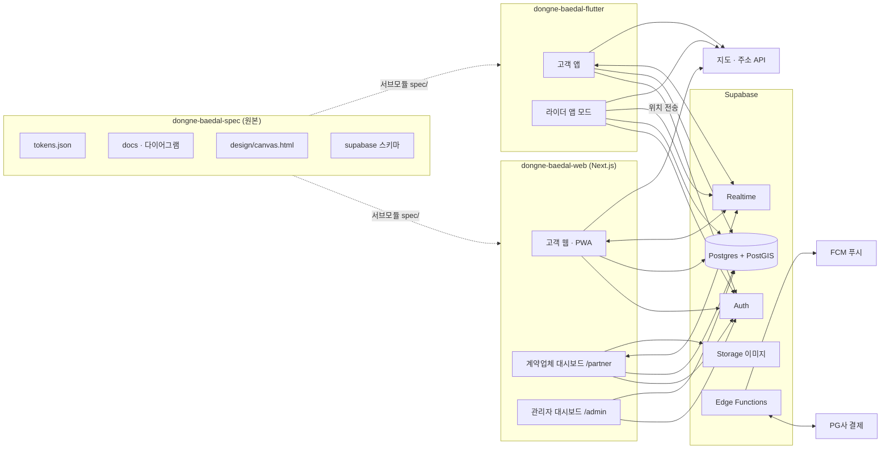

| 역할 | 채널 | 주요 기능 |
|---|---|---|
| 고객 | Flutter 앱, 웹/PWA | 탐색 · 주문 · 결제 · 배달 추적 · 리뷰 |
| 라이더 | Flutter 앱(라이더 모드) | 배차 수락 · 픽업 · 배달 · 위치 전송 · 수익 |
| 계약업체 | 웹 `/partner` (태블릿·PC 중심) | 주문 접수 · 상품 등록 · 매출/정산 |
| 관리자 | 웹 `/admin` (PC) | 입점 심사 · 주문/결제 관제 · 라이더 관제 · 정산 승인 |

---

## 2. 고객 앱 메뉴 구조 (IA)

배민의 「하단 탭 + 홈 상단 서비스 탭」 구조를 따릅니다.

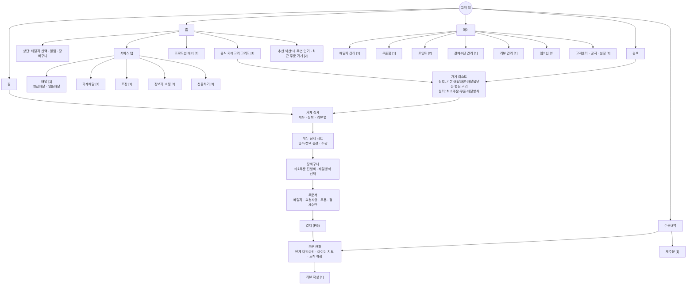

### 고객 기능 목록

| 영역 | 기능 | 단계 |
|---|---|---|
| 인증 | 휴대폰 인증, 카카오·네이버·애플 로그인 | 1 |
| 위치 | 현재 위치로 배달지 설정, 주소 검색, 배달지 여러 개 저장 | 1 |
| 탐색 | 카테고리, 검색(가게·메뉴), 정렬·필터, 배달 가능 반경 내 가게만 노출 | 1 |
| 가게 | 메뉴 카테고리 스티키 탭, 대표 메뉴, 최소주문·배달팁·예상시간, 리뷰·사장님 댓글 | 1 |
| 주문 | 옵션 선택, 장바구니(한 가게 제한), 배달·가게배달·포장 선택, 요청사항 | 1 |
| 결제 | 카드·간편결제, 쿠폰 적용, 결제 취소 | 1 |
| 추적 | 실시간 상태, **라이더 위치 지도**, 도착 예정 시간, 푸시 알림 | 1 |
| 사후 | 리뷰(별점·사진), 재주문, 영수증 | 1 |
| 확장 | 포인트, 장보기, 선물하기, 멤버십(무료배달) | 2·3 |

---

## 3. 라이더 앱 메뉴 구조

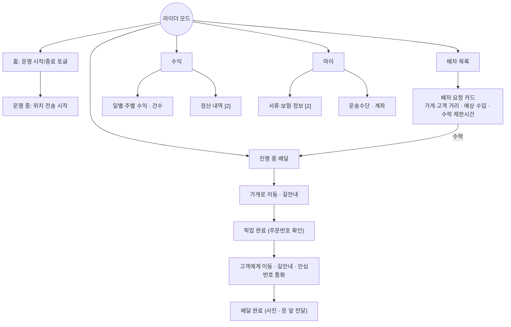

---

## 4. 계약업체(업주) 대시보드 메뉴 구조

```mermaid
flowchart TD
  P((계약업체 /partner)) --> P0[홈 요약]
  P --> P1[주문 관리]
  P --> P2[상품 관리]
  P --> P3[가게 관리]
  P --> P4[매출·정산]
  P --> P5[리뷰 관리]
  P --> P6[쿠폰·프로모션 2]
  P --> P7[계정·계약]

  P0 --> P0a["오늘 매출 · 주문 수 · 평균 조리시간 · 신규 리뷰"]
  P1 --> P1a["신규 → 접수(조리시간 선택) / 거절(사유)"]
  P1 --> P1b["조리중 → 조리완료(라이더 호출)"]
  P1 --> P1c["배달중 · 완료 · 취소 내역"]
  P2 --> P2a["메뉴 카테고리 등록 · 정렬"]
  P2 --> P2b["메뉴 등록: 이름 · 설명 · 가격 · 사진 · 대표/인기"]
  P2 --> P2c["옵션 그룹: 필수/선택 · 최소/최대 선택 수 · 추가금"]
  P2 --> P2d["품절 처리 · 숨김"]
  P3 --> P3a["영업시간 · 휴무일 · 임시 영업중지"]
  P3 --> P3b["배달 반경 · 최소주문 · 배달팁 구간"]
  P3 --> P3c["배달방식: 배달 / 가게배달 / 포장"]
  P4 --> P4a["매출 그래프: 일·주·월"]
  P4 --> P4b["정산 예정액 = 매출 − 수수료 − 배달비 − 쿠폰부담"]
  P4 --> P4c["정산 내역 · 세금계산서 다운로드"]
  P5 --> P5a["리뷰 목록 · 사장님 댓글"]
  P7 --> P7a["사업자 정보 · 정산 계좌 · 계약 수수료율"]
```

---

## 5. 관리자(본사) 대시보드 메뉴 구조

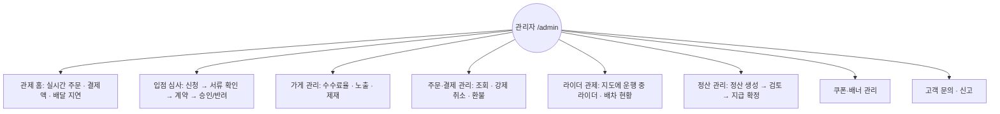

---

## 6. 주문 흐름 (시퀀스)

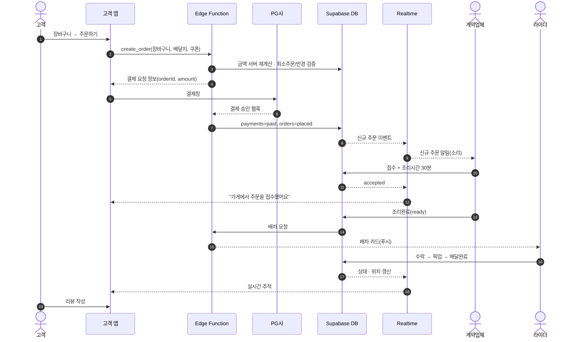

---

## 7. 주문 상태 머신

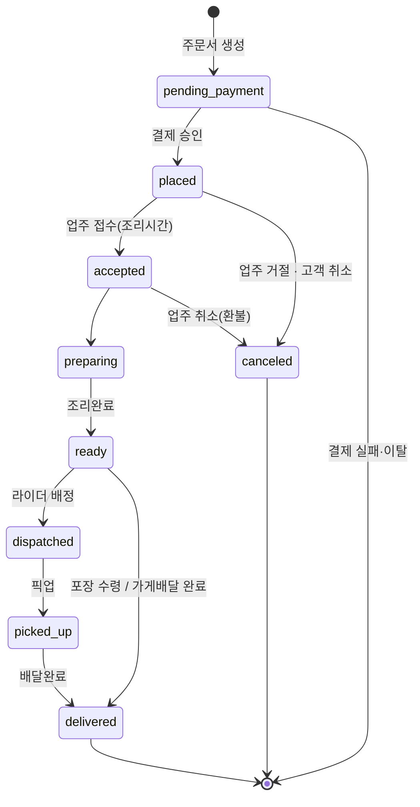

| 상태 | 고객 문구 | 업주 화면 | 색 토큰 |
|---|---|---|---|
| placed | 가게에서 확인하고 있어요 | 신규 | order.placed |
| accepted/preparing | 맛있게 조리하고 있어요 | 조리중 | order.preparing |
| ready/dispatched | 라이더가 가게로 가고 있어요 | 픽업대기 | order.ready |
| picked_up | 라이더가 출발했어요 | 배달중 | order.pickedUp |
| delivered | 배달이 완료됐어요 | 완료 | order.delivered |
| canceled | 주문이 취소됐어요 | 취소 | order.canceled |

---

## 8. 라이더 위치 확인 (위치 기반)

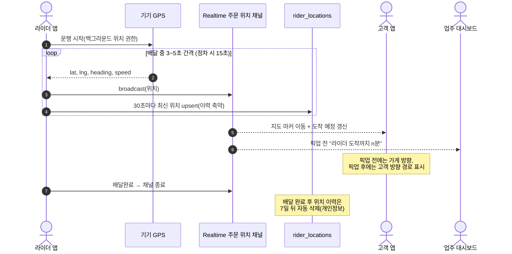

**위치 설계 기준**

| 항목 | 기준 |
|---|---|
| 실시간 전달 | Supabase Realtime Broadcast (DB 쓰기 없이 전달) |
| 저장 | `rider_locations`에 라이더당 최신 1행 + 주기적 이력 |
| 공개 범위 | 배정된 주문의 고객·업주만 구독 가능, 배달 완료 시 차단 |
| 거리 계산 | PostGIS `geography`로 가게 반경·라이더 배차 거리 계산 |
| 배터리 | 이동 중 3~5초, 정차 시 15초로 간격 조절 |
| 도착 예정 | MVP: 직선거리 ÷ 평균속도, 2차: 지도 API 경로 시간 |

---

## 9. 라이더 상태 머신 · 배차

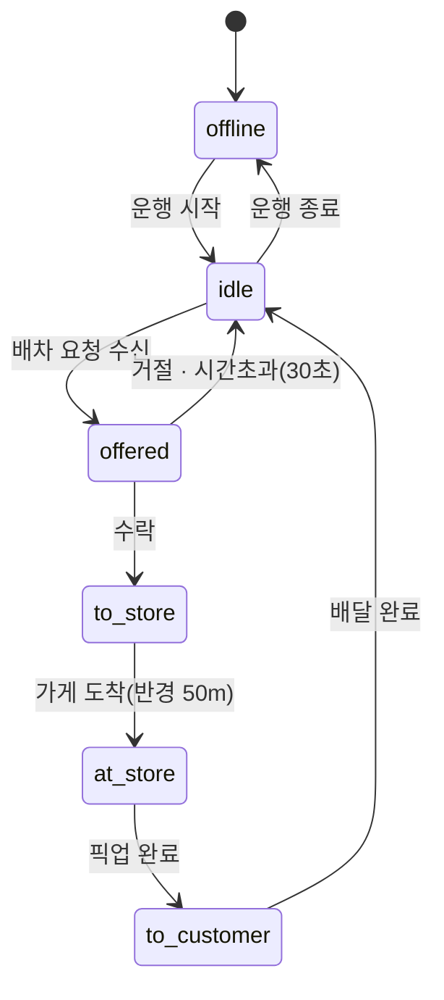

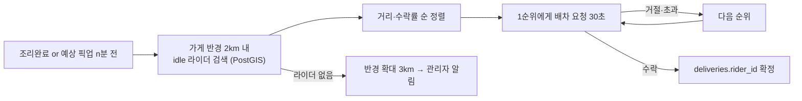

---

## 10. 계약업체 입점 · 상품 등록 흐름

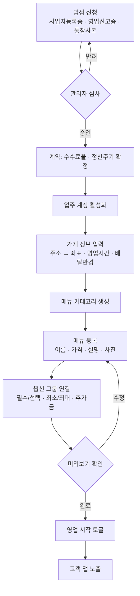

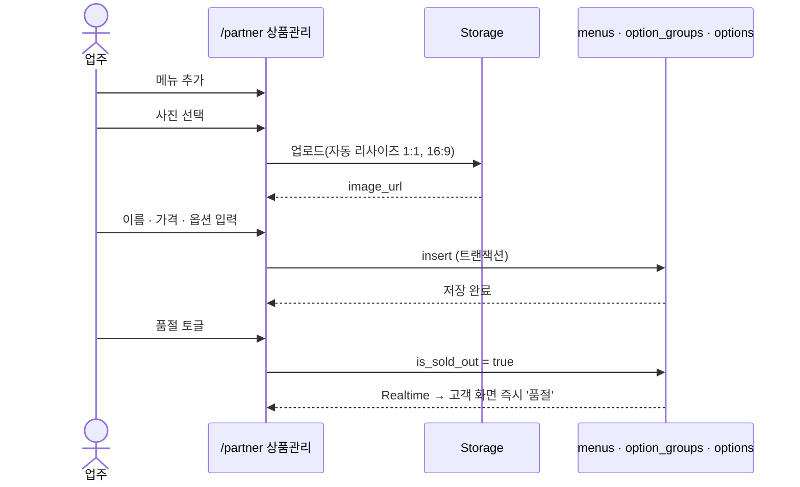

---

## 11. 결제 흐름 (결제 · 취소 · 환불)

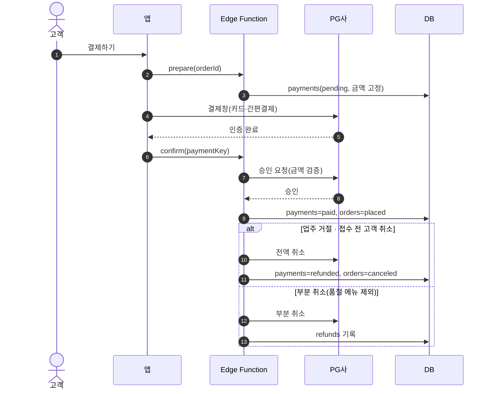

---

## 12. 정산 흐름 · 정산 대시보드 데이터

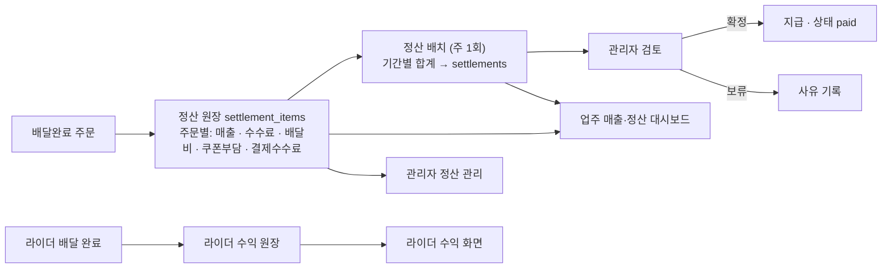

**정산 계산식 (주문 1건)**

```
정산액 = 주문금액(메뉴합계)
       − 중개수수료 (주문금액 × 계약 수수료율)
       − 결제수수료 (결제금액 × PG 수수료율)
       − 배달비 업주부담분
       − 업주부담 쿠폰
       + 고객이 낸 배달팁 (가게배달인 경우)
```

| 대시보드 | 지표 |
|---|---|
| 업주 | 오늘·이번주·이번달 매출, 주문 수, 객단가, 취소율, 정산 예정액, 지급 내역, 시간대별 주문 |
| 관리자 | 총 거래액(GMV), 수수료 수익, 결제수단 비율, 환불액, 정산 대기·확정·지급 현황 |
| 라이더 | 오늘 수익, 건수, 운행시간, 주간 정산 |

---

## 13. ERD (확장)

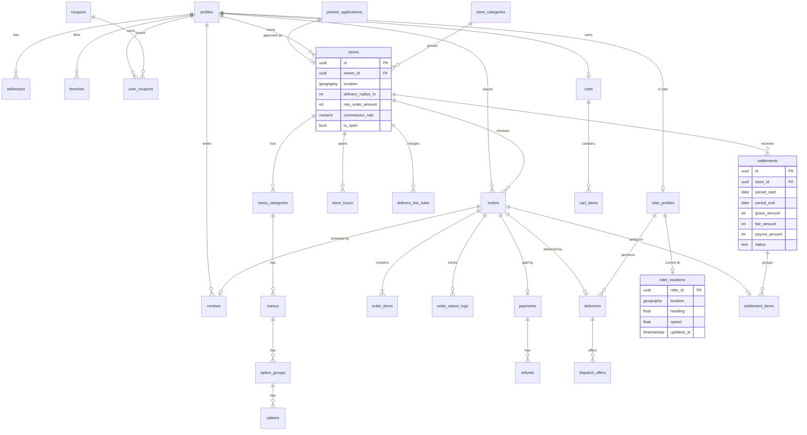

> 참고: `supabase/migrations/0001_init.sql`은 이 확장 ERD 이전 초안입니다. 개발 단계에서 이 ERD 기준으로 다시 맞춥니다.
